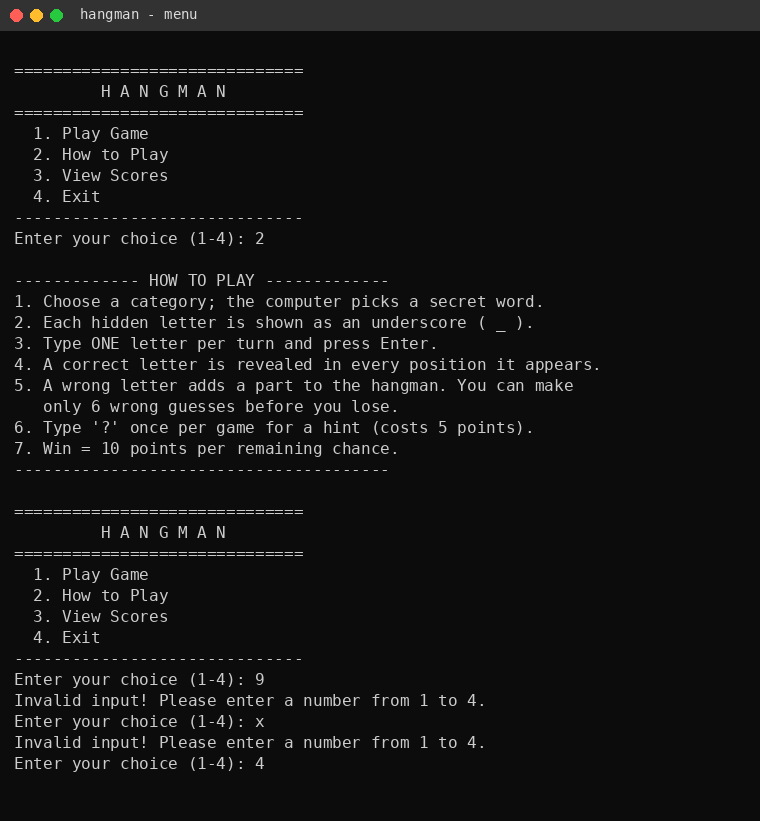
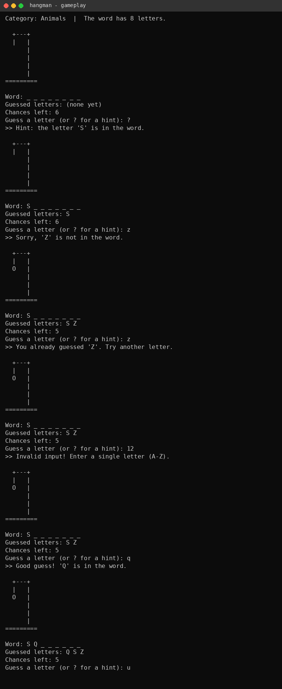
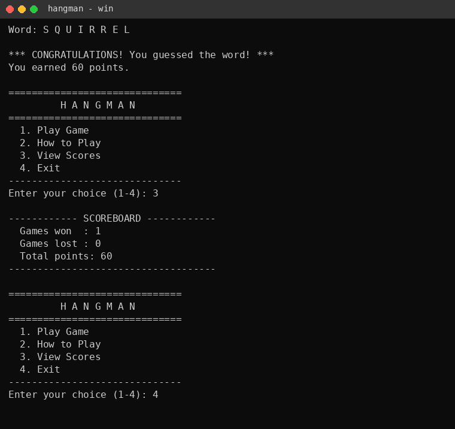
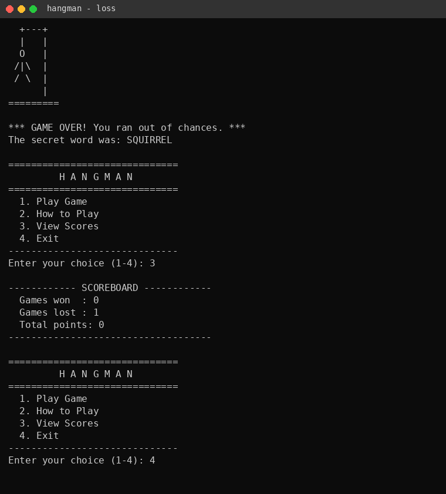

# Project_Hangman

**FOCP-I (C Programming) Mini Project: Console-based Hangman Game**

## Team Members

| S.No | Name | Roll No. | Role |
|------|------|----------|------|
| 1 | **Prabal** | **26CSU243** | **Team Leader: design, coding** |
| 2 | Mayank Garg | 26CSU247 | Team member | Testing
| 3 | Tanmay Pahwa | 26CSU241 | Team member | Documentation

## Description

Hangman is a word-guessing game played in the console. The computer secretly picks a word from the category you choose (Animals, Fruits and Vegetables, or Programming). The word is shown as underscores. You guess one letter at a time; correct letters are revealed in every position they occur, while each wrong guess adds a part to the hangman. Find the whole word before making 6 wrong guesses to win.

## Features

- Menu-driven interface: Play, How to Play, View Scores, Exit
- Three word categories with 8 words each (24 words in total)
- Random word selection using `rand()` and `srand(time(NULL))`
- Word displayed with underscores for hidden letters
- ASCII-art hangman that grows with every wrong guess
- Tracks guessed letters and remaining chances
- Input validation: rejects numbers, symbols, multiple characters and repeated guesses (repeats cost nothing)
- One hint per game (type `?`) that costs 5 points
- Session scoreboard: wins, losses and total points
- Clear win/loss messages, and the secret word is revealed on a loss

## C Concepts Used

Strings and character arrays, pointers (`const char *`), 2D arrays, user-defined functions, loops, `switch`, conditional statements, random number generation, `strtol` / `fgets` based input handling.

## How to Compile and Run

```bash
gcc -Wall -Wextra hangman.c -o hangman
./hangman          # on Windows: hangman.exe
```

The program compiles with no warnings under `gcc -Wall -Wextra -pedantic`.

## How to Play

1. Choose **1. Play Game** and pick a category.
2. Type one letter and press Enter.
3. Type `?` once per game for a hint.
4. You lose after 6 wrong guesses. Win to earn 10 points for every remaining chance.

## Repository Structure

```
Project_Hangman/
├── hangman.c          # complete source code
├── README.md
├── screenshots/       # menu, gameplay, win and loss screens
└── docs/              # completed project documentation (DOCX)
```

## Screenshots

| Menu | Gameplay |
|------|----------|
|  |  |

| Win | Loss |
|-----|------|
|  |  |
